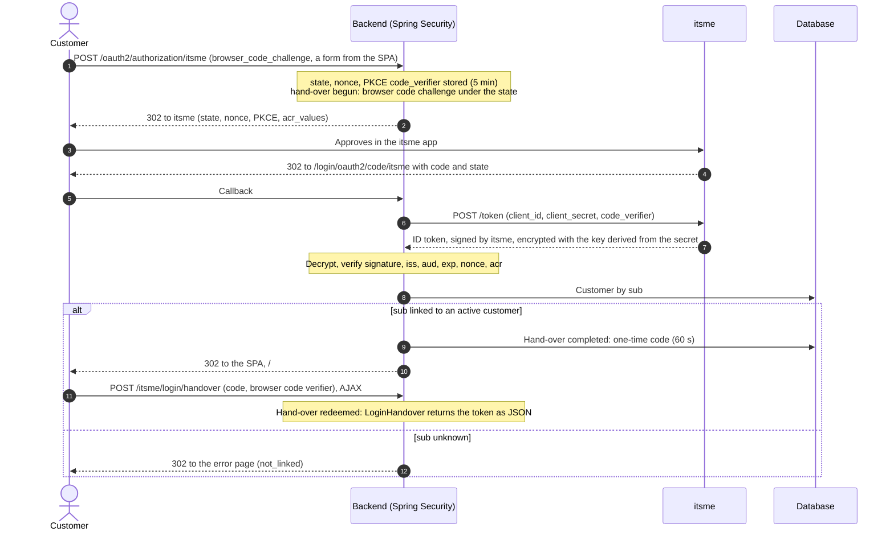
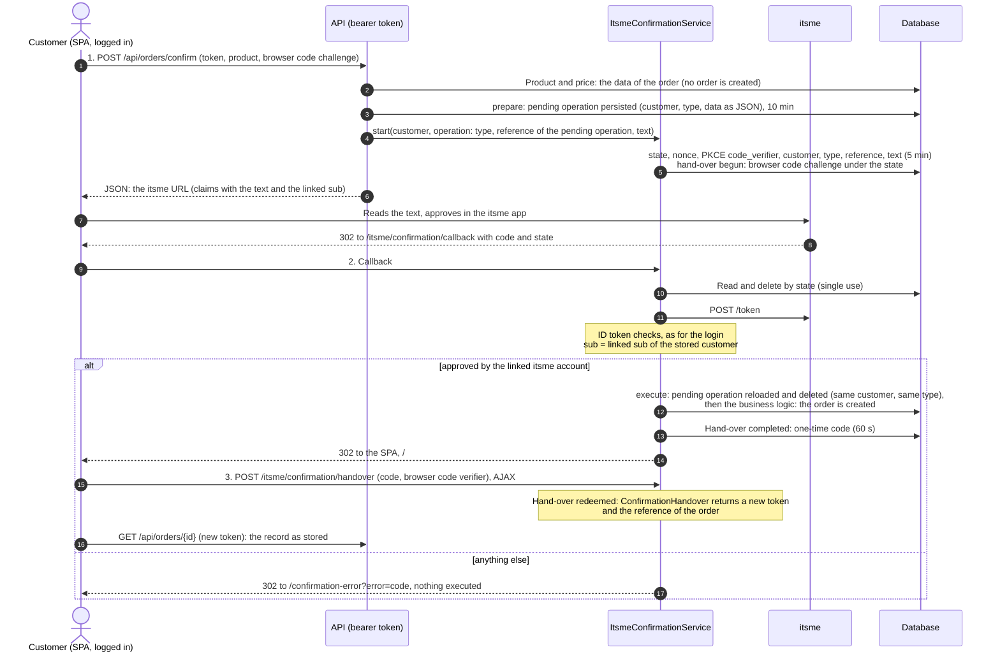

# itsme login with Spring Security — reference sample

A runnable reference implementation of a customer login with **itsme** (OpenID Connect, itsme API **v2**) in a **stateless Spring Boot 4 backend**, for a fictitious energy supplier, *VoltaHome*.

- **Client secret** authentication (`client_secret_post`): the authorization parameters travel in the URL, and ID tokens are signed by itsme and encrypted with a key derived from the secret. See [Client authentication](#client-authentication).
- **Authentication, not identification**: no personal data is requested from itsme. The customer is found through the itsme `sub` (a pseudonym) already linked to their account; an itsme account that is not linked is refused. See [Authentication, not identification](#authentication-not-identification).
- **Confirmation of an operation**: a logged-in customer approves one operation in the itsme app (place an order, accept an offer), from a button in the protected portal. The data of the operation is persisted as JSON in an intermediate table when the confirmation starts, and reloaded once itsme has confirmed: an order does not exist before it is confirmed. The approval counts only if it comes from the itsme account linked to that customer; the operation is then executed at once, at the itsme callback. See [Confirmation of an operation](#confirmation-of-an-operation).
- **A single page application, no cookie**: the itsme callbacks are on the backend. After a login, and after a confirmation, the backend sends the browser back to the SPA with a one-time code; the SPA redeems it with an AJAX call and gets the application's token as JSON (a new one after a confirmation). See [Hand-over](#hand-over) and the guide for the SPA developer, [docs/spa-handover.md](docs/spa-handover.md).
- **Runs with IntelliJ and a JDK only**: no database server, no itsme credentials, and no Docker needed. Docker is optional; see [Run with Docker](#run-with-docker). In the tests, itsme is replaced by **WireMock**; when the application runs locally, it serves an **itsme stub** itself (`local` profile). The database is **H2 in memory**.

> **Scope of the stubs.** WireMock and the itsme stub reproduce our reading of the public itsme v2 documentation. They prove that the code is consistent with that reading, not with itsme's real behaviour. Points marked *to be confirmed in E2E* must be verified against the itsme E2E environment.

---

## Start here

New to the project? Follow this order; it takes about an hour. For the reasoning behind each choice, read the [walkthrough](docs/walkthrough.md) next. New to Spring Security? [Spring Security classes in this sample, explained](docs/spring-security-classes.md) describes each class in plain words. Working on the frontend? [itsme in a single page application](docs/spa-handover.md) lists the calls the SPA makes.

1. **Run it.** Run the tests, then the browser demo: [Quick start in IntelliJ](#quick-start-in-intellij) and [Run the login in a browser](#run-the-login-in-a-browser).
2. **See the whole login.** Read the diagram in [Login flow](#login-flow).
3. **Learn the rules.** Read [Rules you must not change](#rules-you-must-not-change) before you change any code.
4. **Read five files, in this order:**

| File | What it shows |
|---|---|
| `security/SecurityConfig.java` | Where each itsme part is plugged into Spring Security |
| `itsme/ItsmeAuthorizationRequestResolver.java` | What we send to itsme |
| `itsme/ItsmeClientConfig.java` | How the ID token is decrypted and checked (`idTokenDecoderFactory`) |
| `itsme/ItsmeOidcUserService.java` | How the itsme `sub` becomes our customer |
| `itsme/JpaAuthorizationRequestRepository.java` | How a login in progress survives without a session |

5. **Read the tests as a list of attacks.** Start with `ItsmeLoginFlowTest`: each test changes one thing in a valid login and states the expected answer.

### Glossary

| Term | Meaning in this sample |
|---|---|
| `sub` | The user id itsme gives us: a stable pseudonym, specific to our client. It says "same itsme account as last time", not who the person is. |
| `acr` | The authentication level. We require `acr_advanced` (itsme code); `acr_basic` also allows a fingerprint. |
| `state` | A random value that ties the callback to the login we started. Protects against a forged callback. |
| `nonce` | A random value copied into the ID token. Protects against a replayed ID token. |
| PKCE | `code_verifier` (kept by us) and `code_challenge` (its SHA-256, sent to itsme). Only the holder of the verifier can exchange the authorization code. |
| Authorization code | A short-lived (3 minutes), opaque value that itsme sends back through the browser; the backend exchanges it for the ID token. |
| ID token | A JWT from itsme saying who logged in (`sub`), at which level (`acr`), for which client and login (`aud`, `nonce`). |
| JWS / JWE | A signed JWT (proves who wrote it) / an encrypted JWT (hides the content). |
| Nested JWT | A JWS inside a JWE: signed, then encrypted. itsme ID tokens must be nested. |
| Client secret | The secret itsme issues to our client. It authenticates us at the token endpoint and is the source of the ID token decryption key. |
| JWKS | A JSON set of public keys. itsme publishes its own; we use them to verify the RS256 signature of ID tokens. |
| Discovery document | itsme's published configuration (`.well-known/openid-configuration`). Here it is only compared with our configuration, never used as a source. |
| Service code | The itsme service our client uses, sent as the `service:<code>` scope. The login and the confirmation use two different services (`service-code`, `confirmation.service-code`). |
| Hand-over | How the end of an itsme flow reaches the SPA: a one-time code in the URL fragment, redeemed by the SPA with its browser code verifier; `LoginHandover` (after a login) or `ConfirmationHandover` (after a confirmation) then issues the application's own token. |
| Browser code verifier, browser code challenge | The SPA's pair for the hand-over: a random secret it keeps in the browser before each flow, and its S256 hash, sent at the start. Redeeming the code requires the verifier, so only the browser that started the flow can. Not PKCE's `code_verifier` / `code_challenge`, which are between the backend and itsme. |
| Confirmation | An itsme service type: the customer approves one operation, whose text is shown in the itsme app (a WYSIWYS template, "what you see is what you sign"). |

---

## Contents

- [Start here](#start-here)
- [Quick start in IntelliJ](#quick-start-in-intellij)
- [Run the login in a browser](#run-the-login-in-a-browser)
- [Run with Docker](#run-with-docker)
- [What the sample demonstrates](#what-the-sample-demonstrates)
- [Authentication, not identification](#authentication-not-identification)
- [Client authentication](#client-authentication)
- [Project structure](#project-structure)
- [Login flow](#login-flow)
- [Configuration](#configuration)
- [Authorization request](#authorization-request)
- [Token request](#token-request)
- [ID token validation](#id-token-validation)
- [Customer mapping](#customer-mapping)
- [Login in progress](#login-in-progress)
- [Stateless security configuration](#stateless-security-configuration)
- [Hand-over](#hand-over)
- [Confirmation of an operation](#confirmation-of-an-operation)
- [Error codes](#error-codes)
- [Rules you must not change](#rules-you-must-not-change)
- [Using the code in a real application](#using-the-code-in-a-real-application)
- [Points to confirm in itsme E2E](#points-to-confirm-in-itsme-e2e)
- [Test data](#test-data)

---

## Quick start in IntelliJ

Requirements: IntelliJ IDEA (Community edition is enough) and JDK 17 or later. Maven is bundled with IntelliJ.

Stack: Spring Boot 4.0.7 (Spring Framework 7, Spring Security 7, Jackson 3), Nimbus JOSE + JWT (managed by Spring Boot), Spring Data JPA (Hibernate), H2, WireMock 3.

1. **Open the project**: *File → Open…*, select `pom.xml`, choose *Open as Project*. IntelliJ downloads the dependencies.
2. **Check the JDK**: *File → Project Structure → Project → SDK* = 17 or later.
3. **Run the tests**: select the run configuration **All tests** (top-right of the window) and click *Run*, or right-click `src/test/java` → *Run 'All Tests'*.

`ItsmeLoginFlowTest` covers the protocol (authorization request, client secret, ID token, state, hand-over). `ClientSecretHs256LoginFlowTest` covers what differs when itsme signs ID tokens with HS256. From a terminal, `./mvnw verify` (`mvnw.cmd verify` on Windows) does the same; the Maven wrapper downloads Maven 3.9.11 on first use and checks its SHA-256.

---

## Run the login in a browser

1. Select the run configuration **VoltaHome (local, itsme stub)** and click *Run*. It starts `VoltaHomeApplication` with `-Dspring.profiles.active=local`.
   Without the shared run configuration: *Run → Edit Configurations → + → Application*, main class `com.example.voltahome.VoltaHomeApplication`, VM options `-Dspring.profiles.active=local`.
2. Open <http://localhost:8080> and click **Log in with itsme**.
3. The **itsme stub** page shows what the application asked for, read from the URL, and offers test itsme accounts:

| itsme account | Expected result |
|---|---|
| Alex Martin — itsme linked | The protected portal (customer `C-1001`), shown by the SPA from the protected API |
| Sam Peeters — customer, itsme not linked | Error page: itsme account not linked |
| Someone who is not a customer | Error page: itsme account not linked (same answer as Sam: the application cannot tell them apart) |
| Robin Dubois — contract closed | Error page: account no longer active |
| Fingerprint only (acr basic) | Error page (ID token rejected) |
| Cancel | Error page: login cancelled |

**Confirm an operation**: on the portal, click **Order** or **Accept offer**. The itsme stub shows the text the itsme app would display, then the same test accounts:

| itsme account | Expected result |
|---|---|
| Alex Martin | Back to the portal; the SPA redeems the one-time code for a new token, reloads the new order or the offer from the API and shows it as confirmed or accepted |
| Sam Peeters, someone who is not a customer, Robin Dubois | Error page: not the itsme account linked to your VoltaHome account (`wrong_person`) |
| Fingerprint only (acr basic) | Error page (ID token rejected) |
| Cancel | Error page: refused in itsme, nothing changed |

**Things to try**
- Remove `acr_values` from the URL of the itsme stub page and reload, then log in as Alex. itsme falls back to the basic level, and the application rejects the ID token: the `acr` check on the response is the protection.

**How the itsme stub works** (`local` package): served by the application under `/itsme-stub/v2`, with its own signing key (`ItsmeStubCrypto`, shared with the tests). It checks the redirect URI, PKCE, a single-use code valid for 3 minutes and the client secret, and returns ID tokens signed with the configured algorithm and encrypted with the key derived from the secret. A request with the confirmation service scope is a confirmation: the stub then requires the `free_text` template in the `claims` parameter, checks the confirmation redirect URI, and shows the text to approve. `ItsmeStubGuard` stops the application if the `local` profile is used with non-localhost endpoints.

Every class of the stub is in the `local` package and starts with `ItsmeStub`. All of them except `ItsmeStubCrypto` exist only with the `local` profile. `ItsmeStubCrypto` is not a Spring bean: it is also the itsme side of the WireMock tests, and a deliberately independent implementation of the itsme cryptography, so that the tests do not check our code against itself. That is why it is public and lives in `src/main`. One setting outside the package also serves local development: `server.max-http-request-header-size` in `application-local.yml`, because the confirmation text reaches the stub, served by the same Tomcat, in the URL.

---

## Run with Docker

Optional, for a machine without a JDK. `compose.yaml` builds no image: the official `maven:3.9.11-eclipse-temurin-17-noble` image runs Maven on a copy of the sources. The checkout is mounted read-only, so nothing is written to it; downloaded dependencies are kept in a named volume.

| Command | What it does |
|---|---|
| `docker compose up demo` | Browser demo, <http://localhost:8080> (as in [Run the login in a browser](#run-the-login-in-a-browser)) |
| `docker compose --profile verify run --rm verify` | Build and all tests (`mvn verify`) |

Keep the `8080:8080` port mapping. The itsme stub runs only with localhost endpoints, and the configured URLs (`application-local.yml`) point at `http://localhost:8080`.

The containers use `mvn` rather than `./mvnw`. The wrapper's pinned checksum is for the `.zip` distribution of Maven, and on a system without `unzip`, as in this image, the wrapper downloads the `.tar.gz` instead, which fails that check.

---

## What the sample demonstrates

| Topic | Choice in the sample |
|---|---|
| Protocol | OpenID Connect Authorization Code flow, itsme API v2 |
| Client authentication | Client secret (`client_secret_post`) — see [Client authentication](#client-authentication) |
| Authorization request | PKCE (S256); `acr_values` and, for a confirmation, `claims` in the URL |
| ID token | Signed (RS256) by itsme, encrypted with a key derived from the secret; HS256 accepted only for a registration that cannot use RS256 |
| Scope | Authentication only, no identification |
| Customer mapping | itsme `sub`, already linked to the customer; an unknown `sub` is refused |
| Data requested from itsme | Nothing: no claim for the login; a confirmation sends the text to approve and the linked `sub` |
| Backend | Stateless: no `HttpSession`; login in progress stored in the database |
| itsme endpoints | Static configuration (outbound proxies and firewalls opened in advance); the discovery document is only used to verify it |
| Session after login | Out of scope: the result is handed over to the application's own token management, which the SPA receives as JSON. No cookie (see [Hand-over](#hand-over)) |
| Confirmation of an operation | From the portal: WYSIWYS `free_text` template in the `claims` parameter; accepted only from the itsme account linked to the logged-in customer; several operations (orders, offers) through one callback |

---

## Authentication, not identification

itsme can do two different things for an application:

- **Authentication**: itsme confirms that the person approving in the app holds a given itsme account, at the requested level (`acr_advanced`). The application receives a `sub`: a stable pseudonym, specific to the application, that says *it is the same itsme account as last time*, not *who* the person is.
- **Identification**: itsme also shares verified identity data about the person (name, birth date, address, national number, and so on), and the application uses it to decide who the person is.

**The sample does authentication only.**

- It requests no claim: the scope is `openid` and the itsme service, and there is no `claims` parameter (`authorizationRequestAsksForNoClaimAndNoIdentityScope`). The [confirmation](#confirmation-of-an-operation) sends the text to approve and the `sub` already linked to the customer, and requests nothing else (`confirmationRequestAsksForTheWysiwysTemplateOnlyNoIdentityClaim`).
- Claims itsme might send anyway are not used and not handed over (`identityClaimsSentByItsmeAreNotHandedOver`). In particular, itsme's `email` is never used to find a customer: itsme does not verify it (`unknownItsmeAccountIsNotIdentifiedByTheEmailItsmeSends`).
- The customer is found by the `sub` alone, in `itsme_link`:

| itsme `sub` | Result |
|---|---|
| Linked to an active customer | Login; the hand-over carries our customer id |
| Linked to an inactive customer | Refused: `no_customer` |
| Not linked | Refused: `not_linked` |

An unknown `sub` is refused rather than handled, because without identification the application has nothing to work with: it cannot tell an existing customer who has not linked itsme from someone who is not a customer, and it does not try.

**Where links come from.** The login reads `itsme_link` and never writes a link. In the sample, links are test data (`data.sql`, and `givenLinked` in the tests). Creating them is out of scope; it is the job of a separate, deliberate step, such as the identification described below.

The same step handles a re-created itsme account. When a user deletes their itsme account and creates a new one, itsme issues a new `sub`, and its documentation asks the application to bind the new `sub` to the customer, replacing the old one. Until that happens, the login refuses the new `sub` with `not_linked`.

### If identification is added later

Identification is a separate feature, not an option of this login. Adding it means:

1. **A separate entry point**, such as "link itsme to my account" or "become a customer", with its own intent. The intent is stored with the login in progress (`itsme_authorization_request`), never read from the callback URL.
2. **Identity claims requested for that intent only.** They travel in the URL and can be edited, so the callback must check what was actually returned.
3. **Matching the verified identity to a customer**, or creating one, and only then writing the `itsme_link` row. This is the step that establishes `sub` → customer.
4. **A separate carrier for identity data.** `ItsmeLoginResult` and the principal stay free of itsme claims.
5. **itsme onboarding and legal checks**: the itsme service must allow those claims, and some (the national number in particular) need a legal basis.
6. **A test for every new rule**, in the style of the existing ones.

The login described in this README stays as it is: the authentication of an already linked `sub`.

---

## Client authentication

The application authenticates to itsme with a client secret.

| | Client secret |
|---|---|
| What itsme gives you | A shared secret |
| Token request | `client_id` + `client_secret` in the body (`client_secret_post`) |
| Authorization parameters | In the URL: visible and editable in the browser |
| ID token encryption | dir + A256GCM, with a key derived from the secret (OIDC Core §10.2, *to be confirmed in E2E*) |
| ID token signature | RS256, itsme's key (default); or HS256, the client secret itself (OIDC Core §10.1), if the itsme registration says so |
| Protection of `acr_values` | The `acr` check on the ID token |
| If the secret leaks | Intercepted codes can be exchanged, captured ID tokens decrypted |
| Infrastructure | Secret in a vault, rotation arranged with itsme (restart needed) |
| Code | `ItsmeClientConfig` (registration, decoder), `ItsmeCrypto.idTokenDecryptionKey`, `ItsmeCrypto.idTokenSignatureKey` (HS256) |

The ID token must be signed inside the encryption (`requireNestedSignedJwt`): anyone holding the secret can encrypt, so encryption alone proves nothing about the origin. Startup fails without `itsme.client-secret`.

**HS256 signature.** At registration, itsme lets a client secret client choose how the ID token is signed: RS256 with itsme's key, or HS256 with the client secret. Choose RS256 whenever you can. If the registration is HS256 and cannot be changed, set `itsme.id-token-signature: HS256`:

- the signature is checked with the UTF-8 bytes of the client secret, used as they are (OIDC Core §10.1; no hash, unlike the decryption key), through Nimbus `SingleKeyJWSKeySelector`;
- exactly one algorithm is accepted, the configured one: with `HS256`, an RS256 token is refused, and with `RS256` (default), an HS256 token is refused. Accepting both would let a token pass with the wrong kind of key;
- startup fails if `HS256` is set with a client secret shorter than 32 bytes (256 bits, RFC 7518 §3.2);
- the cost: anyone who holds the client secret can now make a valid ID token, not only itsme. What still proves the origin is that the token comes straight from itsme's token endpoint over TLS, in exchange for a single-use code bound to PKCE (OIDC Core §3.1.3.7 accepts TLS as the proof of origin in this case). A leaked secret becomes worse than with RS256, so keep it in the vault and rotate it as soon as a leak is suspected.

---

## Project structure

```
compose.yaml                                 OPTIONAL: run the demo or the tests in a container
mvnw, mvnw.cmd, .mvn/wrapper/                Maven wrapper (Maven 3.9.11, checksum verified)

src/main/java/com/example/voltahome
├── itsme/
│   ├── ItsmeProperties.java                 configuration
│   ├── ItsmeClientConfig.java               client registrations (login, confirmation), token client, ID token decoder
│   ├── ItsmeAuthorizationRequestResolver    PKCE + acr_values
│   ├── ItsmeClaims.java                     claims: none for the login; the free_text template and the linked sub for a confirmation
│   ├── ItsmeCrypto.java                     nested signed JWT check
│   ├── AcrValidator.java                    authentication level check
│   ├── ItsmeOidcUserService.java            customer by sub, principal without itsme claims
│   ├── ItsmeLinkRepository.java             itsme sub → customer (read only; entity ItsmeLink)
│   ├── JpaAuthorizationRequestRepository    login in progress in the database
│   ├── StoredAuthorizationRequest(Repository)  its JPA entity and Spring Data repository (itsme_authorization_request)
│   ├── NoOpAuthorizedClientRepository       the itsme access token is not stored
│   ├── ItsmeDiscoveryCheck.java             configuration vs. discovery document
│   ├── ItsmeHandover.java                   hand-over to the SPA, login and confirmation: begin, complete, redeem (one table)
│   ├── StoredHandover(Repository)           its JPA entity and Spring Data repository (itsme_handover)
│   ├── ItsmeLoginSuccessHandler.java        end of the login: one-time code, redirect to the SPA
│   ├── ItsmeLoginHandoverController.java    POST /itsme/login/handover: the SPA redeems the code
│   ├── ItsmeLoginFailureHandler.java        error code redirect
│   ├── LoginHandover.java                   boundary with token management, after a login
│   ├── ItsmeLoginResult.java                what is handed over (no itsme claim)
│   ├── ItsmeConfirmationService.java        confirmation of an operation: start, complete (check itsme's answer, execute)
│   ├── ConfirmedOperationExecutor.java      boundary with the application: executes a confirmed operation
│   ├── ItsmeConfirmationCallbackController  /itsme/confirmation/callback: execution, one-time code, redirect to the SPA
│   ├── ItsmeConfirmationHandoverController  POST /itsme/confirmation/handover: the SPA redeems the code
│   ├── ConfirmationHandover.java            boundary with token management, after a confirmation
│   ├── ItsmeConfirmedOperation.java         what is handed over after a confirmation (no itsme claim)
│   ├── ItsmeOperation.java                  what the customer is asked to approve: type, reference, text
│   ├── ItsmeFreeText.java                   the text shown in the itsme app (free_text template)
│   ├── JpaConfirmationRequestRepository     confirmation in progress in the database
│   ├── StoredConfirmationRequest(Repository)  its JPA entity and Spring Data repository (itsme_confirmation_request)
│   ├── ItsmeConfirmationResult.java         a confirmed operation, as stored at the start (no itsme claim)
│   └── ItsmeConfirmationException.java      not confirmed: error code
├── operation/                               the operations a customer confirms with itsme, by type
│   ├── ConfirmableOperation.java            one kind of operation: type, data, text to approve, business logic
│   ├── ConfirmableOperationDispatcher.java  all of them: prepare persists at the start, execute reloads and applies at the callback
│   ├── JpaPendingOperationRepository.java   operations waiting for their confirmation (pending_operation, JSON data)
│   ├── StoredPendingOperation(Repository)   its JPA entity and Spring Data repository
│   └── OperationException.java              not started or not executed: error code
├── security/SecurityConfig.java             stateless filter chain
├── customer/                                customer lookup (stands in for the existing customer table)
├── fraud/                                   fraud signals (demo implementation)
├── demo/                                    DEMO ONLY: hand-overs issuing a demo bearer token (DemoLoginHandover,
│                                            DemoConfirmationHandover, DemoToken), the protected API and its filter
│                                            chain (DemoController, DemoSecurityConfig), the confirmation start
│                                            (DemoConfirmationController) and execution
│                                            (DemoConfirmedOperationExecutor), two confirmable operations
│                                            (DemoOrderConfirmation, DemoOfferAcceptance) with their JPA entities
│                                            and repositories (DemoProduct, DemoOrder, DemoOffer), confirmed operations
│                                            (DemoConfirmedOperations), the SPA's routes (DemoWebConfig)
└── local/                                   LOCAL ONLY (profile "local"): the itsme stub, a stand-in for itsme
    ├── ItsmeStubController.java             the stub's endpoints and its approval page (/itsme-stub/v2)
    ├── ItsmeStubScenario.java               test itsme accounts offered by the stub page
    ├── ItsmeStubCrypto.java                 itsme's side of the crypto; also used by the tests (see below)
    ├── ItsmeStubGuard.java                  stops the application if the stub would run with non-localhost endpoints
    └── ItsmeStubSecurityConfig.java         filter chain that opens /itsme-stub/** without login

src/main/resources/static/index.html         DEMO ONLY: the SPA (one page, plain JavaScript)

src/test/java/com/example/voltahome
├── support/ItsmeIntegrationTest.java        application + H2 + WireMock itsme, helpers
├── support/ItsmeWireMock.java               WireMock stubs + ID token builder (itsme format)
├── support/MutableClock.java                test clock, to test expiry without waiting
├── support/TestClockConfig.java             makes MutableClock the application clock in tests
├── itsme/ItsmeLoginFlowTest.java            protocol scenarios and hand-over to the SPA
├── itsme/ClientSecretHs256LoginFlowTest.java  an HS256 ID token signature
├── itsme/ItsmeClientConfigTest.java         configurations refused at startup (no secret, HS256 with a short secret)
├── itsme/ItsmeCryptoTest.java               nested signed JWT check
├── itsme/ItsmeConfirmationFlowTest.java     confirmation scenarios: the data, the right person, the ID token, the hand-over, the state
├── itsme/ItsmeFreeTextTest.java             the text shown in the itsme app
├── demo/DemoTokenTest.java                  protected API and its demo bearer token
└── local/ItsmeStubGuardTest.java            itsme stub refused outside localhost
```

---

## Login flow



---

## Configuration

`application.yml`, prefix `itsme`. Endpoints are **static**: Spring Boot's `issuer-uri` is not used, so startup does not depend on reaching itsme, and the hosts are known in advance for proxy and firewall requests.

| Property | Description |
|---|---|
| `client-id`, `service-code` | Issued by itsme at onboarding |
| `client-secret` | Required; injected from a vault |
| `id-token-signature` | `RS256` (default) or `HS256`, as registered at itsme; see [Client authentication](#client-authentication) |
| `redirect-uri` | Absolute URL, identical to the value registered at itsme |
| `acr` | `http://itsme.services/v2/claim/acr_advanced` (itsme code required) |
| `endpoints.issuer` | Copy the exact value from the discovery document of each environment |
| `endpoints.authorization-uri`, `token-uri` | `https://idp.[e2e/prd].itsme.services/v2/...` |
| `endpoints.jwk-set-uri` | Value of `jwks_uri` in the discovery document |
| `endpoints.discovery-uri` | Used only by `ItsmeDiscoveryCheck` |
| `proxy.host`, `proxy.port` | Outbound proxy; empty host = direct connection |
| `confirmation.service-code` | The itsme service registered as a *Confirmation* service, issued at onboarding |
| `confirmation.redirect-uri` | Absolute URL of `/itsme/confirmation/callback`, identical to the value registered at itsme |

Outside the `itsme` prefix, the SPA routes where the backend sends the browser back: `app.login-handover-url` (it gets `#handover=<code>`, see [Hand-over](#hand-over)), `app.confirmation-handover-url` (it gets `#confirmation=<code>` once the operation is executed), `app.login-error-url` and `app.confirmation-error-url` (they get `?error=<code>`). They are configuration, never read from a request, so the callbacks cannot be used as an open redirect.

Network flows: outbound only, from the backend to one itsme host per environment (token endpoint, itsme JWKS, discovery). itsme requires TLS SNI.

`ItsmeDiscoveryCheck` compares the configuration with the discovery document at startup and every day at 06:00. It returns `OK`, `MISMATCH` (logged at `ERROR`, to be wired to alerting) or `UNREACHABLE` (logged as a warning). It never blocks startup.

---

## Authorization request

`ItsmeAuthorizationRequestResolver` uses Spring's resolver (state, nonce, PKCE), and a customizer adds `acr_values` (`acr_advanced`). The login sends no `claims` parameter. Everything travels in the URL, where it can be edited: the `acr` check on the ID token is the protection of the authentication level.

---

## Token request

Spring sends `client_id`, `client_secret` and the PKCE `code_verifier` in the body (`client_secret_post`). Error responses are read with itsme's field names: itsme puts the description in `detail` instead of `error_description`, and the sample keeps it for the logs (`tokenEndpointErrorDetailIsKept`). The `RestClient` has an explicit outbound proxy: by default the JDK `HttpClient` follows the JVM-wide proxy settings, and setting it explicitly keeps the route to itsme visible in the itsme configuration.

---

## ID token validation

Spring's default ID token decoder cannot decrypt JWE. `ItsmeClientConfig.idTokenDecoderFactory` replaces it:

| Check | Where |
|---|---|
| Encrypted and nested signed JWT (`cty: JWT`) | `ItsmeCrypto.requireNestedSignedJwt` |
| Decryption: dir / A256GCM with the key derived from the secret | Nimbus `JWEDecryptionKeySelector` |
| Signature RS256 with itsme's JWKS | Nimbus `JWSVerificationKeySelector` |
| Or, with `id-token-signature: HS256` only: signature HS256 with the client secret | Nimbus `SingleKeyJWSKeySelector` |
| `iss`, `aud`, `iat` | Spring `OidcIdTokenValidator` |
| `exp` (60 s skew) | Spring `JwtTimestampValidator` |
| `nonce` | Spring (built in) |
| `acr` | `AcrValidator` — *presence of the claim to be confirmed in E2E* |

Why the nested check matters: anyone holding the client secret can encrypt a token for us. Only itsme's signature proves where the token comes from. With an HS256 signature, the secret can sign as well: the check still refuses an unsigned token, and the origin rests on the token endpoint (see [Client authentication](#client-authentication)).

---

## Customer mapping

`ItsmeOidcUserService` replaces Spring's `OidcUserService`, which would copy every claim into the principal. It:

1. looks up the customer by the itsme `sub` (`ItsmeLinkRepository`);
2. unknown `sub` → `not_linked` (see [Authentication, not identification](#authentication-not-identification));
3. linked but inactive customer → `no_customer`;
4. linked and active → the principal carries the `sub` and our customer id, nothing else.

---

## Login in progress

Between the redirect to itsme and the callback, `state`, `nonce` and `code_verifier`, and the hand-over begun by the SPA (see [Hand-over](#hand-over)), must survive, possibly on another instance. `JpaAuthorizationRequestRepository` stores them in `itsme_authorization_request` for 5 minutes. At callback time the row is read and deleted; checking the number of deleted rows makes it single-use without database-specific SQL, even when two callbacks arrive at the same time. Abandoned rows are purged every 15 minutes.

### Database access

The tables are read and written with **Spring Data JPA**. Each table has an entity and a repository interface, kept as small as possible: saving and reading by id are the methods `JpaRepository` already has (`save`, `findById`), and the expiry is checked in Java (`isValidAt`). An interface only declares what Spring Data cannot provide: the checked deletes and conditional updates below, and the finders that must be limited to a customer. `schema.sql` creates the tables, and Hibernate only checks at startup that the entities match them (`spring.jpa.hibernate.ddl-auto: validate`). Three choices matter for the single-use rule (rule 11):

- **A checked delete is a query, not `deleteById`.** `deleteById` loads the row, removes it and returns nothing. The repositories declare `@Modifying @Query("delete ...")` methods that return `int`: one `DELETE` statement, and the number of rows it deleted. Each interface is `@Transactional`, so these statements can also run outside a transaction (the scheduled purges). The same goes for the conditional updates (`StoredHandoverRepository.complete`, `DemoOfferRepository.accept`). The queries are JPQL: no database-specific SQL.
- **A row is inserted, never merged.** The ids are assigned by the application (`state`, a UUID), so Spring Data's `save()` would first look for the row and update it if it exists. The `Stored*` entities implement `Persistable` with `isNew()` always true: `save()` is an `INSERT`, and a second row with the same `state` fails instead of replacing the first.
- **No open session in view** (`spring.jpa.open-in-view: false`): a database session lasts one transaction, not the whole request, and the read and the delete of a single-use row are in the same transaction (`@Transactional`).

The tables that are only read (`customer`, `itsme_link`, the demo's `product`) have repositories that extend `Repository`, which has no `save()`.

---

## Stateless security configuration

`SecurityConfig` replaces every component that would create an `HttpSession`:

| Setting | Default replaced |
|---|---|
| `JpaAuthorizationRequestRepository` | `HttpSessionOAuth2AuthorizationRequestRepository` |
| `NoOpAuthorizedClientRepository` | `HttpSessionOAuth2AuthorizedClientRepository` |
| `RequestAttributeSecurityContextRepository` | `HttpSessionSecurityContextRepository` |
| `NullRequestCache` | `HttpSessionRequestCache` |
| Custom success handler | `SavedRequestAwareAuthenticationSuccessHandler` |

CSRF protection is disabled in this chain and in the demo API chain because no cookie is set or read anywhere: a forged cross-site request carries no credential, so there is nothing for a CSRF token to protect. The callbacks are protected by `state`, the hand-over by the one-time code and the SPA's browser code verifier, the API by the bearer token. An application that uses cookies keeps its existing CSRF setup. The tests `noSessionIsCreatedDuringTheWholeFlow` and `noSessionIsCreatedDuringTheWholeConfirmation` verify that no session and no `JSESSIONID` cookie are created; `noCookieIsSetDuringTheWholeFlow` and `noCookieIsSetDuringTheWholeConfirmation` that no cookie at all is set.

---

## Hand-over

The frontend is a single page application (SPA) and the application uses **no cookie**: the SPA calls the API with a bearer token. The itsme callbacks are on the backend, because only the backend can exchange the code (client secret, PKCE). But a callback is a browser navigation: it cannot answer with JSON (the browser would display it instead of the SPA), and a token must never travel in a URL.

So **every itsme flow, the login and the confirmation, ends with a hand-over**, in three steps, with one table (`itsme_handover`) and one class (`ItsmeHandover`):

| Step | The SPA | The backend |
|---|---|---|
| 1. **begin** | Generates a random browser code verifier (256 bits) and keeps it in `sessionStorage` (this tab only); sends only its S256 hash, the browser code challenge: for a login, in a form POST to `/oauth2/authorization/itsme` (field `browser_code_challenge`); for a confirmation, in the JSON of the start call (`browserCodeChallenge`) | Stores the browser code challenge under the flow's `state` |
| 2. **complete** | Nothing: the browser is at itsme, then comes back | At the callback (`/login/oauth2/code/itsme` or `/itsme/confirmation/callback`), once every check has passed (and, for a confirmation, once the operation is executed): stores the result behind a one-time code, and redirects to the SPA with the code in the URL **fragment** (`/#handover=<code>` or `/#confirmation=<code>`) |
| 3. **redeem** | Reads the code, removes it from the address bar, posts the code and the browser code verifier to `/itsme/login/handover` or `/itsme/confirmation/handover` | Deletes the code and, if the S256 hash of the verifier is the challenge stored in step 1, returns the result: the token, as JSON |

**What a confirmation hands over.** A new token for the customer (`ConfirmationHandover`), with the type and reference of the executed operation so that the SPA can reload the record. The redemption is an anonymous call, like the login's: it cannot depend on the token of the login, which may have expired while the customer was in the itsme app. The operation itself does not wait for the redemption: it is executed at the callback, and a code that is never redeemed, or redeemed too late, undoes nothing. The customer then logs in again to see the record. See [Confirmation of an operation](#confirmation-of-an-operation).

The browser code verifier and challenge are built like PKCE's (RFC 7636, S256), but they are a separate pair: PKCE's `code_verifier` is generated by Spring and stays between the backend and itsme. Nimbus computes the hash (`CodeChallenge.compute`); it needs `json-smart`, which Spring Security leaves out, so the sample declares it.

The SPA developer's guide, with the requests, the responses, and which class handles each URL, is [docs/spa-handover.md](docs/spa-handover.md).

**Why the login starts in a Spring filter, not in one of our controllers.** `oauth2Login()` already does the login correctly: `state`, `nonce` and PKCE, storing the request, the redirect, matching the callback to it, the redirect URI check, the token request and the ID token checks. Our code plugs into it at the documented points (resolver, repository, user service, handlers), as the [walkthrough](docs/walkthrough.md) explains: replace the smallest part that does not fit, never rewrite the flow. A login controller would have to call all those Spring classes by hand. The confirmation shows what that costs: it cannot use `oauth2Login()`, because it must log nobody in, so `ItsmeConfirmationService` rebuilds the exchange itself.

**How the login's redemption is bound to the browser that started it.** The code travels through the browser's address bar: it is the part that could leak or be forwarded. The browser code verifier stays in the browser until step 3, and then travels only in an HTTPS request body; at the start, only its hash is sent. Whoever sees the challenge (in a log, in the database) still cannot redeem the code, and another browser does not hold the verifier.

**Attacks and their answer** (each has a test):

| Attack | Answer |
|---|---|
| Login CSRF: an attacker logs in with their own itsme account and sends the callback link to a victim | The victim's browser does not hold the attacker's browser code verifier: `invalid_handover` |
| A leaked or forwarded code | Single use, 60 seconds, and useless without the browser code verifier |
| A seen browser code challenge | It is a hash: redeeming needs the verifier itself |
| Guessing a code | 256 random bits; a wrong attempt deletes the code (no second try) |
| A login not started by the SPA (no browser code challenge, or a GET such as a link) | Nothing to hand over: the login ends with `invalid_request` |
| A login code redeemed without browser code verifier | `invalid_handover` |
| Choosing where the callback redirects | The SPA URLs are configuration, never a request parameter |
| Two redemptions at the same time | Read + checked delete: only one succeeds |

**What the SPA keeps during the round trip to itsme.** Only what it needs to finish the flow, in `sessionStorage`: the browser code verifier, and for a confirmation the token it already holds. Nothing about the order or offer: the data of the operation is stored on the server when the confirmation starts. After a confirmation, the SPA reloads the record from the API (`GET /api/orders/{id}`, `GET /api/offers/{id}`) by the type and reference the redemption returns, and shows it as stored. A copy kept in the browser could differ from what was approved and executed (a price changed, a value edited in the developer tools), any script on the page could read it, and it would outlive the logout. No token and no customer data ever goes in a URL: URLs end up in the history, in logs, and in the `Referer` header.

**Limits.** A flow is bound to the browser tab that started it: the verifier is in that tab's `sessionStorage`, so flows started in two tabs do not overwrite each other. If the itsme app brings the customer back in a new tab, a private window or another browser, the redemption fails safely with `invalid_handover` (*to be confirmed in E2E*): a login starts again; a confirmation is executed all the same, and the customer logs in again to see it. A script injected into the SPA (XSS) could read the browser code verifier, but it could read the token too: the SPA writes server data as text only, never as HTML, and the token is short-lived.

**The login's boundary.** When the SPA redeems a login code, `LoginHandover.complete(ItsmeLoginResult)` (customer id, method, level, time — no itsme claim) returns the JSON body. Issuing the application's own token is out of scope; the token travels in that body only, never in a URL or a cookie.

The `demo` package shows the shape of a real application, with stand-ins:

- `DemoLoginHandover` asks `DemoToken` for a JWT signed by the application (HS256, 15 minutes) and returns it with our customer data;
- the SPA (`static/index.html`) keeps the token in `sessionStorage` and sends it as `Authorization: Bearer`. It survives a reload and the round trip to itsme in the same tab;
- `DemoSecurityConfig` adds a filter chain for `/api/**`, evaluated before the main one, which checks the token with Spring's resource server support. Without a valid token: 401;
- `/api/portal` returns the customer from our own customer table.

The signing key is generated at startup and kept in memory: a restart logs everyone out, and several instances would not share it. It is a demo, not a token design. The itsme login itself never makes a later request authenticated (`RequestAttributeSecurityContextRepository` keeps it for the callback request only); only the application's own token does. `DemoTokenTest` lists the attacks on the demo token.

Tests (`ItsmeLoginFlowTest`, nested class `Handover`): `loginStartedWithoutBrowserCodeChallengeCannotBeHandedOver`, `loginStartedWithALinkCannotBeHandedOver`, `browserCodeChallengeIsKeptWithTheLoginAndNotSentToItsme`, `secondFlowWithTheSameStateDoesNotReplaceTheFirst`, `browserCodeChallengeAloneCannotRedeemTheCode`, `loginCodeWithoutBrowserCodeVerifierIsRefused`, `callbackRedirectsToTheSpaWithOnlyAOneTimeCodeInTheFragment`, `handoverReturnsTheTokenAndOurCustomerDataAsJson`, `handoverWithTheVerifierOfAnotherBrowserIsRefusedAndConsumesTheCode`, `handoverCodeCannotBeReplayed`, `unknownHandoverCodeIsRefused`, `handoverCodeExpiresAfterSixtySecondsAndIsPurged`, `failedLoginLeavesNothingToRedeem`, `noCookieIsSetDuringTheWholeFlow`. The same attacks on the hand-over of a confirmation are in `ItsmeConfirmationFlowTest`, nested class `Handover`: see [Confirmation of an operation](#tests).

---

## Confirmation of an operation

itsme offers a third service type besides authentication and identification: **confirmation**. The customer approves one operation in the itsme app, and the app shows the operation's text before the approval. The sample adds it to the portal of the SPA, for two operations: **Order** places an order, which is only created once confirmed, and **Accept offer** accepts an open offer. Both end at the same callback (see [Several operations, one callback](#several-operations-one-callback)).

### What the itsme documentation says

Source: the public [Confirmation](https://belgianmobileid.github.io/doc/confirmation/) and [JOSE](https://belgianmobileid.github.io/doc/JOSE/) pages of the itsme v2 documentation.

- **Same protocol as the login.** The confirmation uses the same endpoints, parameters, token request and ID token as authentication. The differences: a service registered as a Confirmation service (`scope=openid service:<code>`), and a *WYSIWYS template* in the `claims` parameter, which is mandatory.
- **Two templates.** `adv_payment` takes an amount ("a string holding an integer"), a currency and an IBAN. `free_text` takes a text that may use `<b>`, `<i>`, `<u>` and `<br>`, up to 7500 characters, in the ISO-8859-15 character set. Every template claim is `essential: true`, under `http://itsme.services/v2/claim/`.
- **Same client authentication.** The Confirmation service offers the same two methods as authentication, "Private key JWT" and "Client secret". With the client secret, the template travels in the `claims` parameter of the URL, like the other parameters.
- **Nothing comes back about the operation.** The answer is the usual ID token. There is no approval proof, no echo of the text, and no hash of it.

### What it means for the application

Because itsme returns no proof, **the application's own checks are what make an approval count**:

| Question | Answered by | Code |
|---|---|---|
| Is this answer for this confirmation? | `state` (single use, 5 minutes), `nonce`, PKCE | `JpaConfirmationRequestRepository`, Spring's `OidcAuthorizationCodeAuthenticationProvider` |
| Which text is shown to the customer? | Text built on the server from the data of the operation, sent in the `claims` parameter; never read from the callback | `ConfirmableOperation.approvalText`, `ItsmeClaims.confirmation` |
| Is the operation the customer's? | The data is built for the logged-in customer at the start; a record that already exists (an offer) is read for that customer only, at the start and again at execution; an order is created for that customer | `ConfirmableOperation` implementations (`operation_not_found`) |
| Which operation does the approval execute? | The type and reference stored at the start, never the callback URL and never a later request; the reference is a pending operation, reloaded for the same customer and type | `ConfirmableOperationDispatcher.execute` (`unknown_operation`, `operation_not_found`) |
| Is it the customer who started it? | Only a call with that customer's bearer token can start a confirmation and create its `state`; the callback finds the customer through that single-use `state` | `ItsmeConfirmationService.start`, `JpaConfirmationRequestRepository` (`confirmation_not_found`) |
| **Was it approved by the right person?** | The ID token `sub` must be the itsme account linked to that customer *now*. Any other itsme account is refused and reported as a fraud signal (`WRONG_ITSME_ACCOUNT`) | `ItsmeConfirmationService.complete` (`wrong_person`) |
| Was the itsme code used? | `acr_advanced`, as for the login | `AcrValidator` |
| Is the ID token from itsme? | Nested signed JWT, decryption, signature, `iss`, `aud`, `exp` | The same decoder as the login (`idTokenDecoderFactory`) |

Without the `sub` check, any itsme account could approve the operation, for example a fraudster's own account, in a session where the fraudster is logged in as the victim.

### Choices made in the sample

- **The text in the URL.** `ItsmeConfirmationService.start` adds `claims` (the `free_text` template, the text, and the linked `sub`) to the request Spring builds, as JSON in the URL. Whatever the URL carries, the operation executed is the one stored at the start (rule 13). A long text makes a long URL: at most 7500 characters, more once encoded (*to be confirmed in E2E*: the length itsme accepts).
- **`free_text` only.** `adv_payment` describes the amount as "a string holding an integer" without saying in which unit (euros or cents). Add it once that is confirmed with itsme.
- **Text built, not escaped.** `ItsmeFreeText` emits only the tags itsme renders, checks the length and the character set, and refuses `<`, `>` and `&` in the text: the documentation does not say whether HTML entities are decoded. Control characters (tab, line feed, ...) are refused too: a line break is `<br>`, and the documentation does not say how raw ones are shown.
- **The linked `sub` in the request.** The customer is logged in, so the application knows which itsme account must approve. `claims` carries it as `"userinfo": {"sub": {"value": "<linked sub>"}}`: itsme documents that it then skips its identification page, so the customer does not scan a QR code again (itsme only reads it under `userinfo`). It is a hint for itsme, not a check: the documentation does not say that another account is refused, so the `sub` of the ID token is still compared with the linked account at the callback (`wrong_person`). The `sub` is a pseudonym specific to our client; it is visible in the URL, like the rest of `claims`.
- **Template under `id_token`.** The documentation does not say whether the template goes under `id_token` or `userinfo`. The sample uses `id_token` and never calls UserInfo (*to be confirmed in E2E*).
- **Not a login.** The confirmation registration (`itsme-confirmation`) is not in the login's `ClientRegistrationRepository`, and its callback (`/itsme/confirmation/callback`) is outside `oauth2Login()`. A confirmation `state` cannot end a login, and a login `state` cannot end a confirmation. The confirmation authenticates nobody: its result is never put in a security context.
- **Confirmed in itsme, executed at once.** The start is an API call with the customer's token. The callback checks itsme's answer and, once every check has passed, executes the operation (`ConfirmedOperationExecutor`): the customer confirmed it in the itsme app, and that confirmation is what counts. Nothing more is asked of the browser. The callback carries no credential: what it relies on is the single-use `state`, which only a call with the customer's token can create, and the itsme account that approved.
- **Back to the SPA with a one-time code, then a new token.** The callback redirects to `app.confirmation-handover-url` with `#confirmation=<code>`. The SPA redeems the code with its browser code verifier (`POST /itsme/confirmation/handover`) and receives what `ConfirmationHandover` returns: a new token and the type and reference of the executed operation (see [Hand-over](#hand-over)). It then reloads the record with that token (`GET /api/orders/{id}`, `GET /api/offers/{id}`). The redemption executes nothing and its failure undoes nothing.
- **The result is the evidence.** `ItsmeConfirmationResult` carries the customer, the operation type and reference, the text sent to itsme, the level and the time, and no itsme claim. A real application executes the operation and keeps this record in its audit trail, with the reference of the record it created or changed. The demo keeps it in memory (`DemoConfirmedOperations`) and lists it on the portal.

### Several operations, one callback

A real application asks for confirmation of several kinds of operations: place an order, accept an offer, and so on. The record may not exist before the confirmation: in the demo, an order is created in `customer_order` only once it is confirmed, while an offer already exists in `offer` and is accepted. So an operation works from its **data**: everything needed to execute it, persisted as a JSON document in an intermediate table, `pending_operation`. `ConfirmableOperationDispatcher` has two steps: **prepare persists** the data when the confirmation starts, and **execute reloads** it, then applies the business logic, once itsme has confirmed. The operations share one itsme confirmation service and one callback (`/itsme/confirmation/callback`), so there is one redirect URI to register with itsme:

- **One start endpoint per operation** (`POST /api/orders/confirm`, `POST /api/offers/{id}/accept`). The endpoint fixes the type and builds the data on the server, **for the logged-in customer**: the SPA sends a product code, and the description and the price come from the catalogue (`DemoOrderConfirmation.draft`); for an offer, the data is its id. An unknown product, an offer of another customer, or one that is no longer open, is refused (`operation_not_found`) before anything is persisted or sent to itsme.
- **Prepare persists.** `ConfirmableOperationDispatcher.prepare` builds the text from the data, then inserts a row in `pending_operation` (`JpaPendingOperationRepository.save`): the customer, the type, and the data as JSON in a text column (at most 4000 characters, no database-specific JSON type), written by Jackson from the record the operation declares (`ConfirmableOperation.dataType`). Nothing is written to the application's own tables. The id of that row is the **reference** of the operation: `itsme/` stores the type and the reference with the confirmation in progress (`itsme_confirmation_request.operation_type`, `operation_reference`) without interpreting them, and carries them in the `ItsmeConfirmationResult`.
- **Execute reloads, then applies the business logic.** The callback checks itsme's answer and has the operation executed (`ItsmeConfirmationService.complete`). `ConfirmableOperationDispatcher.execute` picks the operation by the **stored** type, reloads the pending operation by the **stored** reference, for that customer and that type only, deletes it (single use: read, then checked delete), and gives the data to `ConfirmableOperation.execute`, which only holds the business logic. All in one transaction: the pending operation is deleted only if the operation is executed. Nothing in the callback URL chooses the operation. An unknown type is refused (`unknown_operation`); a pending operation that does not exist, has expired, is another customer's or of another type, or holds data the operation cannot read, is refused too (`operation_not_found`).
- **What was approved is what is executed.** The order is created from the persisted data: the description and the price the customer read in the itsme app, even if the catalogue changed in between. Each confirmation creates one order, because its `state` and its pending operation are single use. An operation on an existing record checks it again: accepting an offer is a conditional update limited to the customer and to an open offer (`where o.offerId = :offerId and o.customerId = :customerId and o.status = 'OPEN'`, `DemoOfferRepository.accept`), accepted only if one row changed. Otherwise nothing is executed (`operation_not_found`): this also stops two approvals of the same offer from accepting it twice.
- **Never confirmed, never executed.** A pending operation whose confirmation is refused in itsme, fails a check or is abandoned stays in `pending_operation` until it is purged (10 minutes, longer than the 5 minutes of a confirmation in progress). Nothing can execute it: only the single-use `state` of its confirmation leads to it.
- **Each type is unique.** Two operations with the same type stop the application at startup: a confirmation of one could execute the other.
- **The SPA lands on the right record.** The execution returns the reference of the record it created or changed (the id of the new order, of the accepted offer). The redemption gives it to the SPA with the new token, and the SPA reloads that record from the API (see [Hand-over](#hand-over), "What the SPA keeps during the round trip to itsme").

To add an operation: implement `ConfirmableOperation` (a unique type, a record for its data, the text, the business logic, every query limited to the customer) and add a start endpoint that builds the data and calls `ConfirmableOperationDispatcher.prepare` with that type. Persisting and reloading are done for you.

The stored `approval_text`, kept in the result, records the text sent to itsme for approval. Put in the data everything the text states (the price, the quantity): what is not in the data is read again at execution, and may have changed.

### Flow



### Tests

`ItsmeConfirmationFlowTest` lists the attacks, each against an otherwise valid order by Alex: `linkedItsmeAccountConfirmsTheOrder`, `portalListsTheOperationsOfTheCustomerOnly`, `unknownItsmeAccountCannotConfirmAndIsReported`, `itsmeAccountOfAnotherCustomerCannotConfirm`, `itsmeAccountLinkedWhenTheConfirmationStartedButReplacedSinceCannotConfirm`, `refusalInTheItsmeAppChangesNothing`, `customerNoLongerActiveCannotConfirm`, `confirmationCannotBeStartedWithoutToken`, `confirmationCannotBeStartedWithoutBrowserCodeChallenge`, `browserCodeChallengeIsNotSentToItsme`, `loginEndpointCannotStartAConfirmation`, the data of the operation (`noOrderExistsBeforeTheConfirmation`, `startPersistsThePendingOperationOfTheCustomer`, `refusedStartPersistsNothing`, `orderIsCreatedFromTheReloadedData`, `refusedConfirmationDoesNotExecuteThePendingOperation`, `pendingOperationOfAnotherCustomerIsNotExecuted`, `pendingOperationOfAnotherTypeIsNotExecuted`, `unknownPendingOperationIsNotExecuted`, `priceChangedAfterTheStartDoesNotChangeTheConfirmedOrder`, `priceAndDescriptionCannotBeChosenByTheRequest`, `unknownProductCannotBeOrdered`, `persistedDataThatIsNotAnOrderIsNotExecuted`, `eachConfirmationCreatesOneOrder`), the hand-over (`callbackExecutesTheOperationWhetherTheCodeIsRedeemedOrNot`, `callbackRedirectsToTheSpaWithOnlyAOneTimeCodeInTheFragment`, `redemptionNeedsNoTokenAndReturnsANewOneWithTheReferenceOfTheOrder`, `newTokenOutlivesTheTokenOfTheLogin`, `redemptionAnswerIsNotCached`, `redemptionWithTheVerifierOfAnotherBrowserIsRefusedAndConsumesTheCode`, `browserCodeChallengeAloneCannotRedeemTheCode`, `confirmationCodeWithoutBrowserCodeVerifierIsRefused`, `confirmationCodeCannotBeRedeemedTwice`, `confirmationCodeExpiresAfterSixtySecondsAndIsPurged`, `loginCodeCannotBeRedeemedAsAConfirmation`, `confirmationCodeCannotBeRedeemedAsALogin`, `longestApprovalTextIsKeptIntact`, `callbackRedirectTargetCannotBeChosenByTheRequest`), `loginStateCannotEndAConfirmation`, `confirmationStateCannotEndALogin`, `callbackCannotBeReplayed`, `confirmationExpiresAfterFiveMinutesAndIsPurged`, `noSessionIsCreatedDuringTheWholeConfirmation`, `noCookieIsSetDuringTheWholeConfirmation`, the ID token checks (`basicAcrIsRejected`, `idTokenIssuedForAnotherRequestIsRejected`, `encryptedButUnsignedTokenIsRejected`), and several operations (`offerIsAcceptedThroughTheSameCallback`, `offerOfAnotherCustomerCannotBeSentForConfirmation`, `acceptedOfferCannotBeSentForConfirmationAgain`, `operationInTheCallbackUrlIsIgnored`, `persistedOfferOfAnotherCustomerIsNotExecuted`, `offerAcceptedInTheMeantimeIsNotExecutedTwice`, `unknownOperationTypeIsRefused`, `orderOfAnotherCustomerCannotBeReloaded`). What is sent to itsme: `confirmationRequestCarriesTheTextToApproveInTheUrl`, `confirmationRequestAsksForTheWysiwysTemplateOnlyNoIdentityClaim`, `confirmationRequestNamesTheItsmeAccountLinkedToTheCustomer`, `tokenRequestUsesTheConfirmationRedirectUriClientSecretPostAndPkce`. `ConfirmableOperationDispatcherTest` covers the operations by type (`duplicateOperationTypeFailsAtStartup`, `unknownOperationTypeIsRefusedAtTheStart`, `unknownOperationTypeIsRefusedAtTheExecution`). `ItsmeFreeTextTest` covers the text.

---

## Error codes

`ItsmeLoginFailureHandler` redirects to `app.login-error-url?error=<code>`. That is an SPA route: the SPA maps each code to a fixed message (`static/index.html`) and never displays the raw `error` parameter, which comes from the URL.

| Code | Cause |
|---|---|
| `access_denied` | User cancelled in itsme |
| `authorization_request_not_found` | Unknown, expired (> 5 min) or already used `state` |
| `invalid_grant` | Authorization code expired (3 minutes), already used, or PKCE mismatch |
| `invalid_client`, `unauthorized_client` | Client secret refused, or client not allowed |
| `invalid_id_token` | Decryption, signature, `iss`, `aud`, `exp` or `acr` check failed |
| `invalid_nonce` | Nonce mismatch |
| `invalid_token_response` | Token endpoint unreachable or unreadable response |
| `not_linked` | The itsme account is not linked to a customer |
| `no_customer` | The linked customer is no longer active |
| `invalid_request` | The login was not started by the SPA with a browser code challenge in a POST, so there is nothing to hand over |

Redeeming a code (`POST /itsme/login/handover`, `POST /itsme/confirmation/handover`) answers 400 with `{"error": "invalid_handover"}` when the code is unknown, expired (> 60 s), already used, of the other flow, or sent with another browser code verifier: one answer for all. After a confirmation, this answer does not mean that nothing happened: the operation was executed at the callback.

The confirmation callback redirects to `app.confirmation-error-url?error=<code>` (`ItsmeConfirmationCallbackController`), an SPA route with fixed messages too; the start calls answer 400 with `{"error": "<code>"}` (`DemoConfirmationController`). It passes on the codes above that come from itsme's answer and Spring's checks (`access_denied`, `invalid_grant`, `invalid_client`, `unauthorized_client`, `invalid_id_token`, `invalid_nonce`, `invalid_token_response`), uses `no_customer` with the same meaning, and adds:

| Code | Cause |
|---|---|
| `confirmation_not_found` | Unknown, expired (> 5 min) or already used `state` |
| `wrong_person` | Approved with an itsme account that is not the one linked to the customer (also a fraud signal) |
| `not_linked` | At the start: the customer has no linked itsme account, so nobody could confirm |
| `invalid_request` | At the start: no browser code challenge, so nothing could be handed over. At the callback: neither `code` nor `error` |
| `operation_not_found` | At the start: the product does not exist, or the offer does not exist, is not the customer's, or is no longer open. At execution: the pending operation does not exist, has expired, was already executed, is another customer's or of another type, holds data the operation cannot read, or can no longer be executed (the offer is no longer open) |
| `unknown_operation` | No operation is registered for the stored type |

---

## Rules you must not change

Each rule below protects against an attack or an operational failure. Changing one is a design change: agree it with your solution architect first. A new security rule comes with a new test.

| # | Rule | Why | Guarded by |
|---|---|---|---|
| 1 | **No hand-written cryptography.** Only Nimbus and Spring Security calls, with explicit algorithms. The one exception is the key derivation from the client secret (`ItsmeCrypto.idTokenDecryptionKey`, OIDC Core §10.2), and its deliberately independent copy in `ItsmeStubCrypto`, which must not call production code: it is the reference the tests check us against. | Crypto mistakes do not show in a demo; they show in an incident. | The `IdTokenValidation` tests; `tokenEncryptedWithAnotherSecretIsRejected` |
| 2 | **The ID token must be signed inside the encryption** (`ItsmeCrypto.requireNestedSignedJwt`), with exactly one configured algorithm: RS256 with itsme's key, or, for a client registered so at itsme, HS256 with the secret. | The encryption key is derived from a shared secret: anyone holding it can encrypt a token for us. Only the signature proves where it comes from; accepting two algorithms at once would let a token pass with the wrong kind of key. | `encryptedButUnsignedTokenIsRejected` (all three test classes), `plainJwsIsNotAcceptedAsIdToken`, `hs256TokenIsRejectedWhenRs256IsConfigured`, `rs256TokenIsRejectedWhenHs256IsConfigured`, `tokenSignedWithAnotherSecretIsRejected`, `hs256IsRefusedWithAClientSecretShorterThan256Bits` |
| 3 | **Keep `AcrValidator`.** If itsme E2E shows that `acr` is not sent, report it; do not remove the check. | Without it, a fingerprint approval, or an edited URL, passes as an itsme-code approval. | `missingAcrIsRejected`, `basicAcrIsRejected` |
| 4 | **Find the customer by `sub` only.** Never by itsme's `email` or any other itsme claim. | itsme does not verify the email: anyone can put a victim's address in their own itsme account. | `unknownItsmeAccountIsNotIdentifiedByTheEmailItsmeSends` |
| 5 | **Authentication only.** Request no identity claim; refuse an unknown `sub`; never write `itsme_link` during the login. | See [Authentication, not identification](#authentication-not-identification). | `authorizationRequestAsksForNoClaimAndNoIdentityScope`, `confirmationRequestAsksForTheWysiwysTemplateOnlyNoIdentityClaim`, `unknownItsmeAccountIsRejected` |
| 6 | **No `HttpSession`, ever.** | The backend runs on several instances without sticky sessions; a session would break the callback. | `noSessionIsCreatedDuringTheWholeFlow`, `noSessionIsCreatedDuringTheWholeConfirmation` |
| 7 | **No itsme claim leaves `ItsmeOidcUserService`.** The principal carries the `sub` and our customer id; `ItsmeLoginResult` carries no itsme claim at all. | Personal data that is not passed on cannot leak, be logged or be misused downstream. | `identityClaimsSentByItsmeAreNotHandedOver` |
| 8 | **Static endpoints, no `issuer-uri`.** The discovery document is an alarm, never a source of configuration. | Startup must not depend on reaching itsme, and the hosts must be known in advance for proxies and firewalls. | `discoveryCheckReportsAMovedEndpoint`, `discoveryCheckReportsUnreachableItsme` |
| 9 | **Explicit outbound proxy** on the `RestClient` and on the Nimbus `DefaultResourceRetriever`. | JVM-wide proxy settings change without notice; the route to itsme must be visible in the itsme configuration. | Code review (no automated test) |
| 10 | **The itsme stub refuses non-localhost endpoints** (`ItsmeStubGuard`). | A fake itsme must never reach a shared environment. | `itsmeStubIsRefusedWithARealItsmeEndpoint` |
| 11 | **Single-use login state, confirmation state, pending operations and hand-over codes:** read the row, delete it, and accept it only if exactly one row was deleted. No database-specific SQL: the delete is a JPQL query that returns the number of rows deleted, and a row is inserted, never merged (see [Database access](#database-access)). | Two callbacks with the same `state`, or two redemptions of the same code (double click, replay), must not both succeed; a confirmation must be executed once. | `callbackCannotBeReplayed` (login and confirmation), `concurrentCallbacksWithTheSameStateSucceedOnlyOnce`, `loginInProgressExpiresAfterFiveMinutesAndIsPurged`, `handoverCodeCannotBeReplayed`, `confirmationCodeCannotBeRedeemedTwice`, `orderIsCreatedFromTheReloadedData`, `secondFlowWithTheSameStateDoesNotReplaceTheFirst` |
| 12 | **No cookie, and no token or result in a URL.** Each callback, of the login and of the confirmation, redirects to the SPA with a one-time code in the fragment; redeeming it requires the browser code verifier whose hash the SPA sent in the start request, and a code of one flow cannot end the other. | A token in a URL leaks (history, logs, `Referer`); a code without verifier can be redeemed in another browser (login CSRF, or a token for whoever sees the callback link). | `callbackRedirectsToTheSpaWithOnlyAOneTimeCodeInTheFragment` (login and confirmation), `browserCodeChallengeAloneCannotRedeemTheCode` (login and confirmation), `handoverWithTheVerifierOfAnotherBrowserIsRefusedAndConsumesTheCode`, `redemptionWithTheVerifierOfAnotherBrowserIsRefusedAndConsumesTheCode`, `loginCodeWithoutBrowserCodeVerifierIsRefused`, `confirmationCodeWithoutBrowserCodeVerifierIsRefused`, `confirmationCannotBeStartedWithoutBrowserCodeChallenge`, `loginCodeCannotBeRedeemedAsAConfirmation`, `confirmationCodeCannotBeRedeemedAsALogin`, `noCookieIsSetDuringTheWholeFlow`, `noCookieIsSetDuringTheWholeConfirmation` |
| 13 | **A confirmation executes the operation stored at its start, for that customer, once itsme's answer has passed every check.** The execution happens at the callback, only after the `state`, the ID token and the linked `sub` are checked (`wrong_person` otherwise), and does not depend on the redemption that follows. The data is built on the server and persisted at the start (`pending_operation`); the operation type and the reference of that pending operation are stored with the confirmation in progress, never taken from the callback URL or from a later request; the pending operation is reloaded for the same customer and the same type only. Each `ConfirmableOperation` limits every query to the customer; an operation on an existing record executes it with a conditional update limited to the customer and to an open record, accepted only if exactly one row changed. Operation types are unique. | Otherwise an approval of one operation could execute another: one chosen in the callback URL, another customer's, one of another type, one with a price the customer did not read, or the same record a second time. | `callbackExecutesTheOperationWhetherTheCodeIsRedeemedOrNot`, `unknownItsmeAccountCannotConfirmAndIsReported`, `operationInTheCallbackUrlIsIgnored`, `priceAndDescriptionCannotBeChosenByTheRequest`, `priceChangedAfterTheStartDoesNotChangeTheConfirmedOrder`, `offerOfAnotherCustomerCannotBeSentForConfirmation`, `pendingOperationOfAnotherCustomerIsNotExecuted`, `pendingOperationOfAnotherTypeIsNotExecuted`, `unknownPendingOperationIsNotExecuted`, `persistedOfferOfAnotherCustomerIsNotExecuted`, `offerAcceptedInTheMeantimeIsNotExecutedTwice`, `unknownOperationTypeIsRefused`, `duplicateOperationTypeFailsAtStartup` |

---

## Using the code in a real application

1. Copy the `itsme` and `security` packages; adapt the package names. Keep the [rules](#rules-you-must-not-change) and their tests.
2. Replace `customer/` with the application's customer lookup and `fraud/` with the real fraud monitoring.
3. Implement `LoginHandover` and `ConfirmationHandover` with the application's token management, and the SPA's calls ([docs/spa-handover.md](docs/spa-handover.md)); set the `app.*` URLs to the SPA's routes. Delete `demo/` and `local/` (or keep `local/` for local development only).
4. Create the tables of `schema.sql` (except `customer`) in the application's database (keep `ddl-auto: validate`, or `none`: Hibernate must not create them), and decide how `itsme_link` rows are created: the login only reads them (see [Authentication, not identification](#authentication-not-identification)).
5. Store the client secret in the vault.
6. Fill in the configuration per environment from itsme onboarding and the discovery document; give itsme the redirect URIs.
7. Ask itsme to enforce PKCE for the client.
8. For the confirmation: register a separate Confirmation service and its redirect URI at itsme, implement `ConfirmableOperation` for each operation to confirm (with a record for its data), replace `DemoConfirmationController` with the application's API (one start per operation, with its own token), implement `ConfirmedOperationExecutor` (the demo's is `DemoConfirmedOperationExecutor`), and keep each `ItsmeConfirmationResult` in the operation's audit trail.
9. Run the E2E checks below.

---

## Points to confirm in itsme E2E

- The ID token contains the `acr` claim (otherwise `AcrValidator` rejects every login). The itsme documentation does not say that it does.
- ID token encrypted dir / A256GCM with the key derived from the secret as in OIDC Core §10.2, containing a JWS signed RS256. itsme lets you choose RS256 or HS256 at registration: choose **RS256** when you can. If the registration is HS256, set `itsme.id-token-signature: HS256` and confirm that itsme signs with the client secret's bytes as they are (OIDC Core §10.1).
- Clients onboarded before 25 June 2025 use other endpoints (`https://oidc.[e2e/prd].itsme.services/clientsecret-oidc/csapi/v0.1/...`), and the documentation's example ID token shows an `iss` on the `oidc.` host. Copy the endpoints and the `issuer` from the discovery document of your own client.
- Exact `issuer` and `jwks_uri` values in the discovery document (in PRD, `jwks_uri` is `https://idp.prd.itsme.services/v2/jwkSet`).
- Confirmation: itsme accepts the `free_text` template in the `claims` URL parameter, up to the longest text (7500 characters, URL-encoded JSON), under the `id_token` member of `claims` (the documentation does not say `id_token` or `userinfo`), renders `<b>` and `<br>` as expected, and returns `acr` in the ID token. Check how a refusal in the app is reported (expected: `access_denied`).
- Confirmation: whether HTML entities (`&amp;`) are decoded in `free_text`, and the unit of the `adv_payment` amount, before supporting either.
- SPA: on the phones you support, the itsme app brings the customer back in the tab that started the flow, not in a new tab. The browser code verifier is in that tab's `sessionStorage`: in a new tab, the redemption ends with `invalid_handover`; a login starts again, and a confirmation is executed but the SPA gets no new token to show the record.
- Confirmation: with the linked `sub` in `claims` (`"userinfo": {"sub": {"value": ...}}`), itsme skips its identification page, on desktop and on mobile. Check what happens when that `sub` no longer exists (the customer re-created their itsme account), and whether itsme refuses an approval by another account. Our `sub` check stays either way.

---

## Test data

All data is fictitious. Email addresses use `example.com`, a domain reserved for documentation. The sample requests no identity attribute from itsme.

| Customer | Email | Status |
|---|---|---|
| C-1001 Alex Martin | alex.martin@example.com | Active, itsme linked (`stub-sub-alex`) |
| C-1002 Sam Peeters | sam.peeters@example.com | Active, itsme not linked: the itsme login is refused |
| C-1003 Robin Dubois | robin.dubois@example.com | Inactive, itsme linked (`stub-sub-robin`) |

Demo operations: one product to order, P-100 (the order is created by its confirmation); Alex has offer F-3001 and Sam has offer F-3002, both open.

itsme® is a registered trademark of Belgian Mobile ID. This sample is not affiliated with or endorsed by Belgian Mobile ID.

Licensed under the MIT License; see [`LICENSE`](LICENSE).
